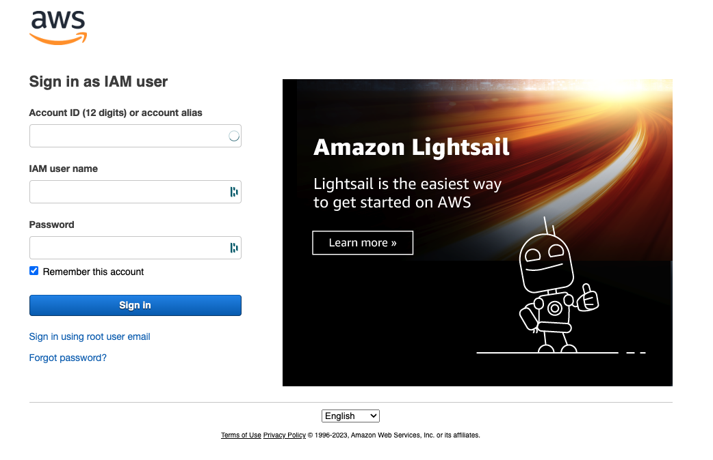
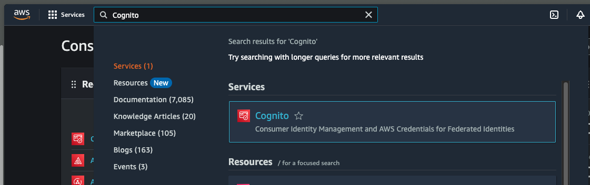
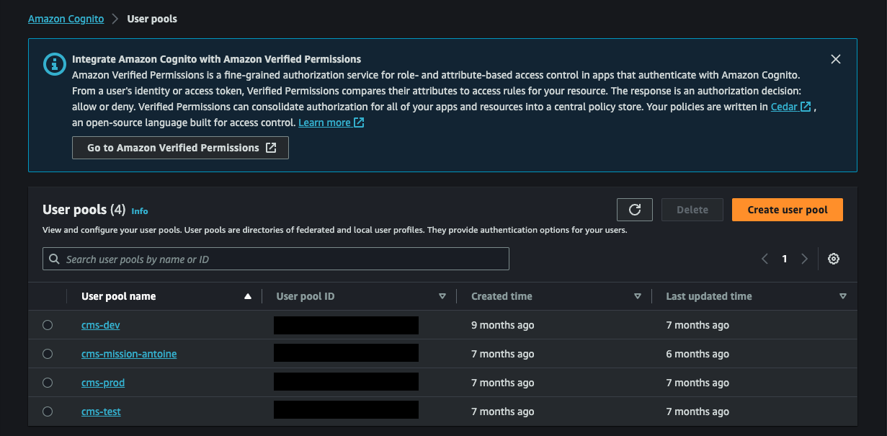
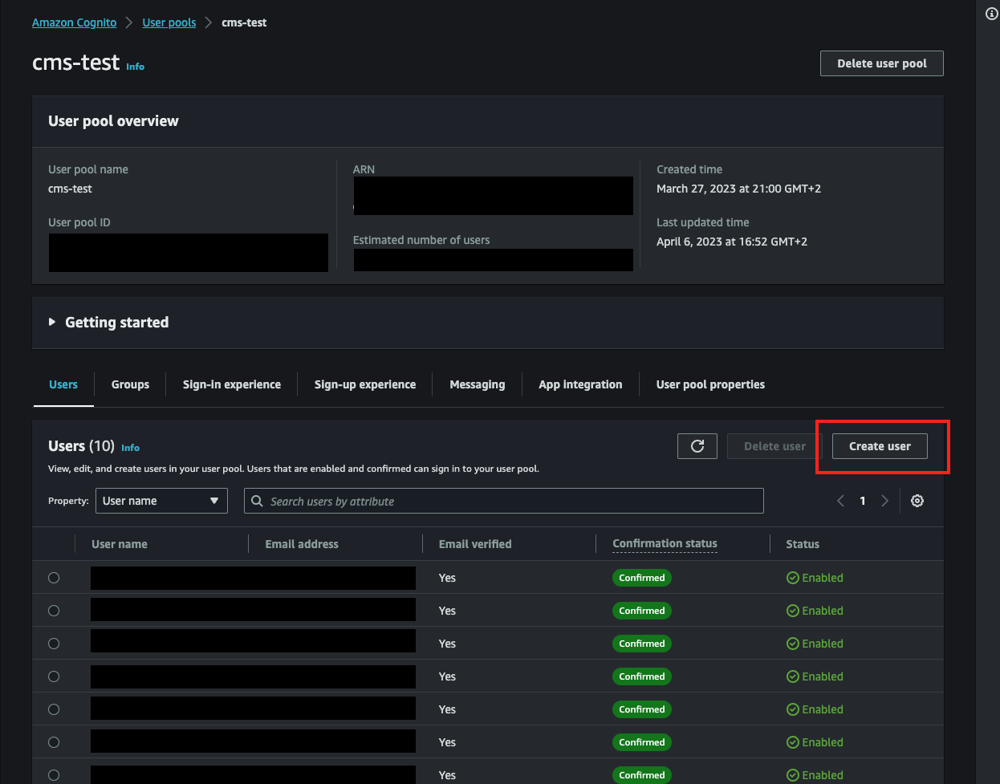
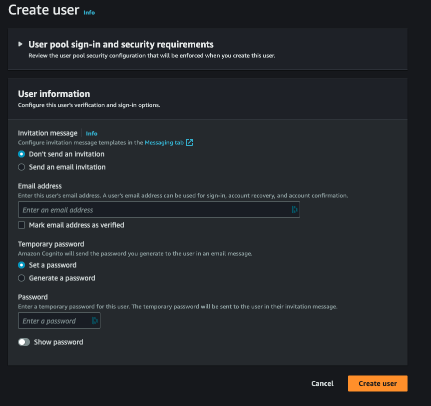

# FC_MC_CMS
Code for CMS built by Mission Cloud for FreeCast
=======
# Getting Started with Create React App

This project was bootstrapped with [Create React App](https://github.com/facebook/create-react-app).

# AWS Amplify Deployment

This repository uses AWS Amplify for continuous deployment. Depending on the branch you push to, the frontend will be deployed to a specific environment. Below are the details:

## Deployment Branches & Environments

- **Dev Branch**:
    - **Branch Name**: `dev`
    - **Deployed Environment**: `dev`
    - **URL**: [https://dev.dy6cf3t8c3zc7.amplifyapp.com/](https://dev.dy6cf3t8c3zc7.amplifyapp.com/)

- **Main Branch**:
    - **Branch Name**: `main`
    - **Deployed Environment**: `main`
    - **URL**: [https://main.dy6cf3t8c3zc7.amplifyapp.com/](https://main.dy6cf3t8c3zc7.amplifyapp.com/)

Please ensure you're pushing to the correct branch to deploy to the desired environment.

# Adding a New User to Amazon Cognito via the Console

Follow the step-by-step guide below to add a new user to Amazon Cognito using the AWS Management Console. For clarity, each step has a screenshot description to guide you on what to capture.

## Step 1: Sign in to the AWS Management Console



## Step 2: Navigate to the Cognito Service

1. In the AWS Management Console, locate the "Services" dropdown.
2. Select "Cognito" under the "Security, Identity, & Compliance" section, or directly type 'Cognito' in the search input.



## Step 3: Select User Pools

1. On the Cognito dashboard, you'll see two options: "Manage User Pools" and "Manage Identity Pools".
2. Click on "Manage User Pools".


## Step 4: Choose your User Pool

1. You'll see a list of your user pools.
2. Click on the user pool to which you'd like to add a new user.



## Step 5: Add a User

1. On the left sidebar, click on "Users and groups".
2. Then click the "Create user" button on the top right.




## Step 6: Fill out the User Details

1. Provide the required details for the new user, such as username, email, phone number, etc.
2. You can also set a temporary password or let the system generate one for you.
3. Once you've filled out all the details, click the "Create user" button.



## Step 7: Confirmation

After successfully adding a user, you should see a confirmation message and the new user should appear in the list of users.

Now, you've successfully added a new user to your Cognito User Pool via the AWS Console. Make sure to communicate any initial login details securely to the new user and instruct them to change their temporary password upon first login, if applicable

## Config the .env file

Create a .env file in the root directory of the project. Add the following variables to the file, like in the .env.sample file.

The values for the variables can be found in the AWS console.

```
REACT_APP_API_URL=
REACT_APP_API_SERVICE_URL=

REACT_APP_USER_POOL_ID=
REACT_APP_REGION=
REACT_APP_USER_POOL_WEB_CLIENT_ID=

REACT_APP_DRM_API_URL=
REACT_APP_DRM_API_KEY=
```


## Available Scripts

In the project directory, you can run:

### `npm start`

Runs the app in the development mode.\
Open [http://localhost:3000](http://localhost:3000) to view it in the browser.

The page will reload if you make edits.\
You will also see any lint errors in the console.

### `npm test`

Launches the test runner in the interactive watch mode.\
See the section about [running tests](https://facebook.github.io/create-react-app/docs/running-tests) for more information.

### `npm run build`

Builds the app for production to the `build` folder.\
It correctly bundles React in production mode and optimizes the build for the best performance.

The build is minified and the filenames include the hashes.\
Your app is ready to be deployed!

See the section about [deployment](https://facebook.github.io/create-react-app/docs/deployment) for more information.

### `npm run eject`

**Note: this is a one-way operation. Once you `eject`, you can’t go back!**

If you aren’t satisfied with the build tool and configuration choices, you can `eject` at any time. This command will remove the single build dependency from your project.

Instead, it will copy all the configuration files and the transitive dependencies (webpack, Babel, ESLint, etc) right into your project so you have full control over them. All of the commands except `eject` will still work, but they will point to the copied scripts so you can tweak them. At this point you’re on your own.

You don’t have to ever use `eject`. The curated feature set is suitable for small and middle deployments, and you shouldn’t feel obligated to use this feature. However we understand that this tool wouldn’t be useful if you couldn’t customize it when you are ready for it.

## Learn More

You can learn more in the [Create React App documentation](https://facebook.github.io/create-react-app/docs/getting-started).

To learn React, check out the [React documentation](https://reactjs.org/).
