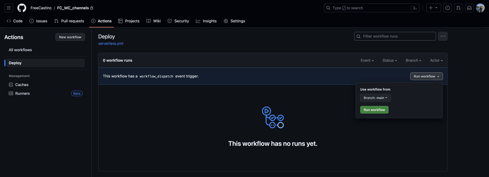

# FreeCast Live Channels Deployment

- [Getting Started](#getting-started)
  - [Setup](#setup)
  - [Deploy](#deployment) 
- [Unit-Tests](#unit-tests)
  - [Watch Mode](#watch-mode)
- [Workflow Test](#workflow-test)

## Getting started

The following steps describe how to deploy the live channels using [Serverless Framework](https://www.serverless.com/framework/docs/getting-started).

### Setup

The following tools need to be installed on your system prior to installing Serverless Framework:

- [Node.js >= 14](https://nodejs.org/download/release/latest-v14.x/)
  - We recommend using a version in [Active LTS](https://nodejs.org/en/about/releases/)
- [Npm >= 8.0.0](https://docs.npmjs.com/downloading-and-installing-node-js-and-npm)

First clone the repository.

```sh
$ git clone git@github.com:FreeCastInc/FC_MC_channels.git
$ cd FC_MC_channels
$ npm install
```

Install the Serverless Framework.

```sh
$ npm install -g serverless
```

### Pre-requis (for new deployment):


Create secret in Secret Manager

1. Navigate to console
2. AWS Secrets Manager
3. Store a new secret
4. Select other type of secret
5. Select Plaintext
6. copy paste:
https://console.keyos.com/#settings/packaging-keys
7. Click next
8. Name it: keyos-userkey
9. Descriptiion: Allows authentication with KeyOS Services
10. Click next 
11. Click next
12. Store

### Deployment

```sh
$ npm install
# Always deploy on prod since quotas have been increased only on prod env
$ sls deploy --stage <stage> 
```

You can deploy directly using [GitHub Actions](https://github.com/FreeCastInc/FC_MC_cms_api/actions/workflows/serverless.yml)



### Remove

```sh
$ sls remove
```


## Unit Tests
Unit-Tests are backed by [Jest](https://jestjs.io/) and located in [test](./tests) directory.

Run tests:
```
$ npm test
```

### Watch Mode
Run tests in watch mode:
```
$ npm run test-watch
```

## Workflow Test
You can test the overall workflow by sending data over SRT to MediaConnect.

Requirements:

- [SRT](https://github.com/Haivision/srt#build-instructions)
- [TSDuck](https://github.com/tsduck/tsduck#usage)

In order to test DAI, we recommend to use the [VANLIFEscte35.m2ts](https://mission-support-assets.s3.us-west-2.amazonaws.com/VANLIFEscte35.m2ts) file including `SCTE-35` ad markers.

```shell
$ tsp -I file --infinite sample.ts -P regulate --bitrate <bitrate> -O ip localhost:4900
```

In another terminal

```shell
$ srt-live-transmit udp://:4900 srt://<media-connect-flow-ip>:<media-connect-flow-port>
```

## Monitoring/Observability
Cloudwatch logs and Metrics are enabled on:
- MediaLive channels
- MediaPackage Ingress
- MediaPackage Egress
- CloudFront distributions
- AWS WAF

## Security

API routes are secured using API keys and Amazon Cognito. Depending on the API route Resource-based policies are used.
Each Lambda functions have a set IAM policies attached.

i.e.:
```
iam: {
  role: {
    statements: [{
      Effect: 'Allow',
      Action: 'secretsmanager:GetSecretValue',
      Resource: 'arn:aws:secretsmanager:us-east-1:1111111:secret:secret-name',
    }],
  },
}
```

Each IAM user has a limited level of permissions according to their needs, and all have MFA enabled.

MediaPackage also uses CDN authorization. MediaPackage only fulfills playback requests that are authorized between MediaPackage and our CDN.
It uses a custom HTTP header

```
X-MediaPackage-CDNIdentifier: 9ceebbe7-9607-4552-8764-876e47032660
```

The value is stored as a Secret Key within AWS Secret Manager

```json
{"MediaPackageCDNIdentifier": "9ceebbe7-9607-4552-8764-876e47032660"}
```

```yml
OriginCustomHeaders: [{
  HeaderName: 'X-MediaPackage-CDNIdentifier',
  HeaderValue: {
    'Fn::Sub': [
      '{{resolve:secretsmanager:${SecretId}:SecretString:MediaPackageCDNIdentifier}}',
      {
        SecretId: {
          'Fn::GetAtt': ['mediaPackageCDNAuthorizationSecret', 'Id'],
        },
      },
    ],
  },
}]
```

In front of the CloudFront distributions we also have Access Control List set thanks to the Web Application Firewall.
It allows to create different combination of complex rules.