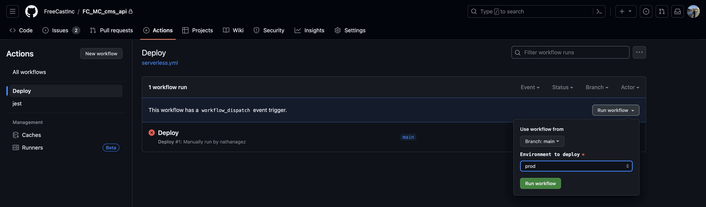
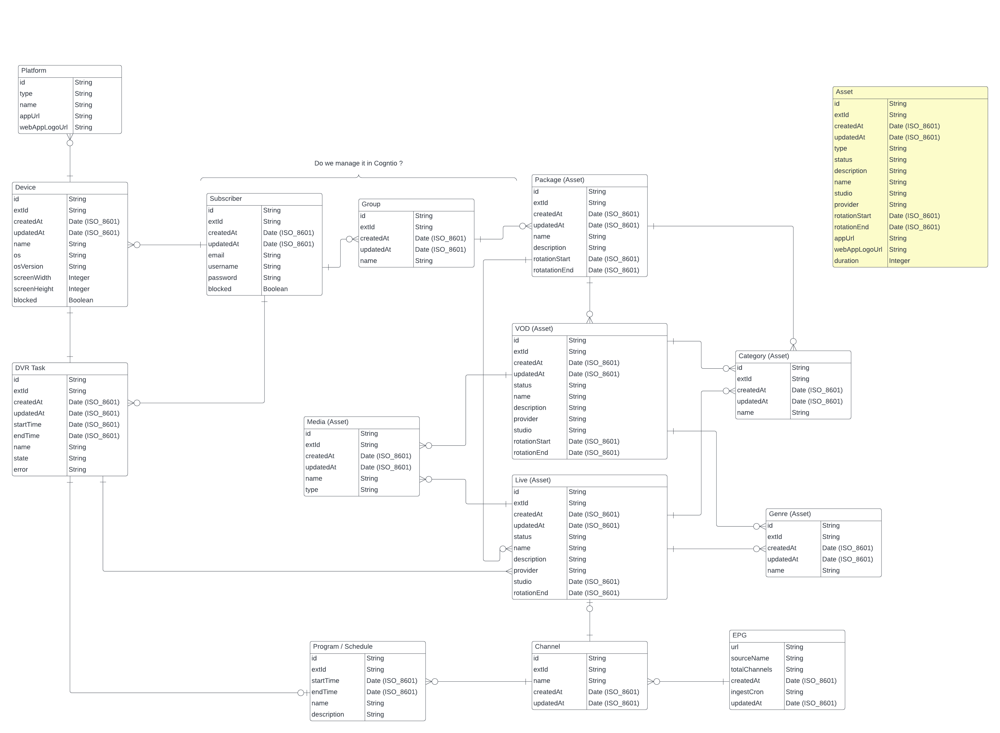
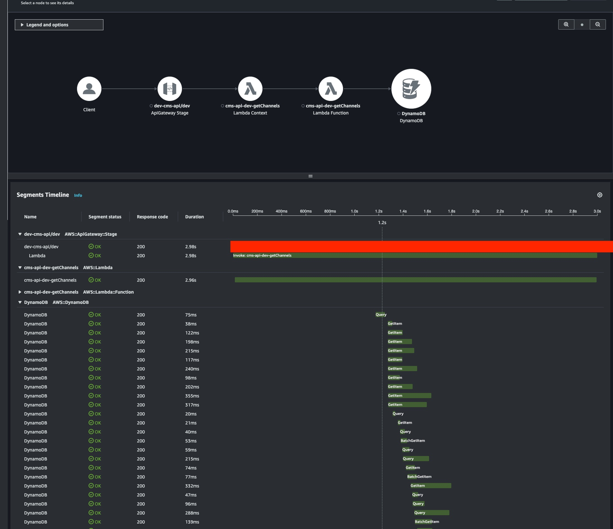

# FreeCast CMS REST API

> 📖 For a detailed overview of the system's structure, architecture, full API surface, media pipeline, and a developer getting-started guide, see [`docs/ARCHITECTURE.md`](./docs/ARCHITECTURE.md).

- [Architecture & Developer Guide](./docs/ARCHITECTURE.md)
- [Getting Started](#getting-started)
    - [Setup](#setup)
    - [Deployment](#deployment)
    - [Serverless stacks](#serverless-stacks)
- [Autoingestion](#autoingestion)
- [Data design](#data-design)
    - [ERD](#erd)
    - [Access Patterns](#access-patterns)
- [Dependencies](#dependencies)
- [Monitoring/Observability](#monitoringobservability)
- [Security](#security)
- [Tests](#tests)
    - [DynamoDB local](#dynamodb-local)
    - [Create table](#create-table)
    - [Drop table](#drop-table)

## Getting started

The following steps describe how to deploy the REST
API [Serverless Framework](https://www.serverless.com/framework/docs/getting-started).

### Setup

The following tools need to be installed on your system prior to installing Serverless Framework:

- [Node.js 22.x](https://nodejs.org/) (matches `nodejs22.x` Lambda runtime)
    - We recommend using a version in [Active LTS](https://nodejs.org/en/about/releases/)
- [Npm >= 8.0.0](https://docs.npmjs.com/downloading-and-installing-node-js-and-npm)

First clone the repository.

```sh
$ git clone git@github.com:FreeCastInc/FC_MC_cms_api.git
$ cd FC_MC_cms_api
$ npm install
```

Install the Serverless Framework.

```sh
$ npm install -g serverless
```

### Deployment

Environments: `dev`, `test`, `qa`, and `prod`. Deploy to the correct stage for your work.

This project uses **two Serverless services** to stay under the CloudFormation 500-resource limit per stack:

```sh
# REST API, DynamoDB, CloudFront, Step Functions, core Lambdas
$ npx serverless deploy --stage <env>

# Scheduled / event-driven workers (see serverless-workers.yml)
$ npx serverless deploy --config serverless-workers.yml --stage <env>
```

CI runs both deploys via [`.github/workflows/deploy-serverless.yml`](./.github/workflows/deploy-serverless.yml) (called from [`serverless.yml`](./.github/workflows/serverless.yml) on push).



### Serverless stacks

| Stack | Config | What it deploys |
|-------|--------|-----------------|
| `cms-api` | [`serverless.yml`](./serverless.yml) | API Gateway routes under `routes/`, shared `sls-resources/`, Step Functions, autoingestion API |
| `cms-api-workers` | [`serverless-workers.yml`](./serverless-workers.yml) | Background Lambdas from [`extra/functions-workers.yml`](./extra/functions-workers.yml) |

Worker Lambdas keep the same function name prefix (`cms-api-<stage>-*`) via `custom.cmsApiService` so cross-stack references (for example EPG validation) stay unchanged.

Lambdas tied to CloudFormation in [`sls-resources/iam.yml`](./sls-resources/iam.yml) (NPVR auto-remover, EPG analytics auto-fix) remain in the **main** stack: [`extra/functions-main.yml`](./extra/functions-main.yml).

**Stack splitting:** [`serverless-plugin-split-stacks`](https://github.com/dougmoscrop/serverless-plugin-split-stacks) with [`stacks-map.js`](./stacks-map.js) moves API Gateway routes, Lambda permissions, log groups, and related resources into nested stacks. Do not enable `perFunction: true` on the main stack—it breaks provider environment variables that reference shared resources (for example CloudFront).


MRSS ingestion should be tested using the `utils/xpath-tester.ts` then tested on the `dev` environment.
Make sure this line is commented on the `dev` environment before testing the MRSS ingestion:

```typescript
await this.mediaTranscoder.transcode(ingestion.id, `episodes/${entity.id}`, (content as MrssEpisode).asset.url, mrssUrl, isPrivate, 1, (content as MrssEpisode).cuePoints, (content as MrssEpisode).subtitles);
await this.mediaTranscoder.transcode(ingestion.id, `movies/${entity.id}`, (content as MrssMovie).asset.url, mrssUrl, isPrivate, 1, (content as MrssMovie).cuePoints, (content as MrssMovie).subtitles);
```

This ensures no MediaConvert jobs are triggered.  

### Remove

Remove both stacks when tearing down an environment:

```sh
$ npx serverless remove --stage <env>
$ npx serverless remove --config serverless-workers.yml --stage <env>
```

## Autoingestion

Configurable MRSS ingestion jobs are stored in DynamoDB and triggered on a cron schedule via EventBridge Scheduler. This replaces hard-coded feeds such as the legacy Reelz/Curiosity worker Lambdas (those crons were removed from the workers stack).

**Routes** (private API, API key required): `routes/autoingestion/`

| Method | Path | Description |
|--------|------|-------------|
| `POST` | `/autoingestions` | Create config and EventBridge schedule |
| `GET` | `/autoingestions` | List all configs |
| `GET` | `/autoingestions/{id}` | Get one config |
| `PATCH` | `/autoingestions/{id}` | Update config (reschedules if `schedule` / `timezone` / `enabled` change) |
| `DELETE` | `/autoingestions/{id}` | Delete config and remove schedule |

**Request body** (create/update) accepts either IDs or names; names are resolved to IDs on save:

| Field | Type | Notes |
|-------|------|-------|
| `provider_name` / `providerID` | string | Provider display name or ID |
| `package_name` / `package_ids` | string or string[] | Package name(s) or IDs |
| `platform` / `platform_ids` | string or string[] | Platform name(s), IDs, or `"all platforms"` for every platform |
| `mrss_feed` | string | MRSS URL |
| `schedule` | string | EventBridge cron (AWS format), e.g. `0 0 * * ? *` |
| `timezone` | string | Optional, default `UTC` |

**Stored record** (response / DB):

| Field | Type | Description |
|-------|------|-------------|
| `providerID` | string | Resolved provider ID |
| `package_ids` | string[] | Resolved package IDs |
| `platform_ids` | string[] | Resolved platform IDs |
| `mrss_feed` | string | MRSS URL |
| `schedule` | string | Cron expression |
| `timezone` | string | Schedule timezone |
| `scheduler_id` | string | EventBridge Scheduler schedule name |
| `ingestion_ids` | string[] | Ingestion run history (for CMS UI) |

On each scheduled run, `autoIngestionScheduleHandler` starts the VOD Step Function, creates an ingestion record, and appends its ID to `ingestion_ids`. Query ingestions with `parentId` equal to the autoingestion id for full run details.

**Example create:**

```json
{
  "provider_name": "Reelz",
  "package_name": "Value Channels",
  "platform": "all platforms",
  "mrss_feed": "https://reelz-mrss.s3.amazonaws.com/Reelz_MRSS_Freecast.xml",
  "schedule": "0 0 * * ? *"
}
```

## Data design

### ERD



### Access patterns
|Entity|Access patterns                                                           |Table/GSI|Key conditions                                   |
|------|--------------------------------------------------------------------------|---------|-------------------------------------------------|
|EPG   |Get all programs given an epgId                                           |Table    |PK=epgId SK=begins_with epg#channel#             |
|      |Get all EPG                                                               |GSI1     |PK=epg                                           |
|      |Get an EPG by id                                                          |Table    |PK=epgId SK=epgId                                |
|IAsset |Get all assets given a type (channel / movie / package...)  sorted by name|GSI1     |PK=entityType                                    |
|      |Get an asset given an ID                                                  |Table    |PK=assetId                                       |
|      |Get all assets given a type sorted by creation date                       |GSI2     |PK=entityType and  ScanIndexForward true or false|
|User  |Get all users                                                             |GSI1     |PK=user#calculatedSuffix                         |
|      |Get users given a group                                                   |GSI2     |PK=group#calculatedSuffix                        |
|      |Get a user given an id                                                    |Table    |PK=userId SK=userId                              |
|Device|Get all devices given a user id                                           |Table    |PK=userId SK=begins_with device#                 |
|      |Get a device given a device id and a userId                               |Table    |PK=userId SK=deviceId                            |
|Group |Get all groups                                                            |GSI1     |PK=group#calculatedSuffix                        |
|      |Get a group given an id                                                   |Table    |PK=groupId SK=groupId                            |
|      |Get groups given a userId                                                 |Table    |PK=userId SK=begins_with group#                  |
|      |Get all users within a group                                              |GSI2     |PK=groupId                                       |
|      |Get packages given a group id                                             |Table    |PK=groupId SK=begins_with package#               |


## Dependencies

Each Lambda Layers contain a single `package.json`.

In order to install all dependencies at once, the script [install-dependencies.js](./utils/install-dependencies.js) recursively
checks for nested `package.json` files within [layers](./layers) when `npm install`is executed from root directory.

## Monitoring/Observability
The API is exclusively serverless and uses AWS Lambda functions. Lambda automatically monitors Lambda functions on our behalf and reports metrics through Amazon CloudWatch.
Most important exposed metrics are:
- **Errors**: whether errors are caused by logic or runtime errors in the code, or caused by interactions with the Lambda service or other services. These may also be caused by other factors such as lack of permissions or exceeding the assigned resources.
- **Execution time**: measuring average response times only provides a limited view of performance in distributed applications. It’s important to capture and monitor performance at percentile intervals (such as 95% and 99%) to measure the performance for the slowest 5% and 1% of requests.
- **Throttling**: serverless applications use scalable resources with Service Quotas to protect customers. Throttling may indicate that quotas are set incorrectly, there is an error in the application architecture, or traffic levels are beyond the expected limits.

In addition to CloudWatch all Lambda functions use [Middy](https://github.com/middyjs/middy), a middleware engine for AWS Lambda and [Powertools for AWS Lambda](https://github.com/aws-powertools/powertools-lambda-typescript). It adds
Tracer, Logger and Metrics utilises to trace Lambda function handlers, create structured logs and send custom metrics.

For tracing, Lambda functions use [AWS X-Ray](https://docs.aws.amazon.com/xray/latest/devguide/aws-xray.html) under the hood 

```typescript
const SERVICE_NAME = 'FreeCast-API-addPlatform';
const logger = new Logger({ serviceName: SERVICE_NAME });
const tracer = new Tracer({ serviceName: SERVICE_NAME });

export default middy<AddPlatformEvent>()
  .use(captureLambdaHandler(tracer))
  .use(injectLambdaContext(logger, { logEvent: true }))
  .use(httpJsonBodyParser())
  .use(validator({ inputSchema }))
  .use(httpEventNormalizer())
  .use(httpHeaderNormalizer())
  .use(cors({
    exposeHeaders: 'Location',
  }))
  .use(errorHandler)
  .handler(addPlatformHandler);
```



## Security

API routes are secured using API keys and Amazon Cognito. Depending of the API route Resource-based policies are used.
Each Lambda functions have a set IAM policies attached.

i.e.:
```yml
        - Effect: Allow
          Action:
            - 'wafv2:*'
            - 'scheduler:*'
            - 'mediapackage-vod:*'
            - iam:GetRole
            - iam:PassRole
            - 'apigateway:GET'
            - 'mediapackage:DescribeChannel'
            - 'mediapackage:DescribeOriginEndpoint'
            - 'mediapackage:CreateHarvestJob'
            - 'mediaconvert:CreateJob'
            - 'states:StartExecution'
            - 'events:Put*'
          Resource: '*'
        - Effect: Allow
          Action:
            - 'cloudfront:CreateInvalidation'
          Resource:
            - !Join
              - ":"
              - - arn
                - aws
                - cloudfront
                - ""
                - !Ref AWS::AccountId
                - !Join
                  - "/"
                  - - distribution
                    - !GetAtt vodDistribution.Id
```

Each IAM user has a limited level of permissions according to their needs, and all have MFA enabled.

## Tests

Unit-Tests are backed by [Jest](https://jestjs.io/) and located in [tests](./tests) directory.
In order to run tests correctly, you first need to spin-up DynamoDB locally using Docker.

### DynamoDB local

```
$ docker-compose up
```

Run tests:

```
$ npm test
```

Run tests in watch mode:

```
$ npm run test-watch
```


### Create table

Tables are automatically created during tests, but you can create additional tables using [create-table.ts](./utils/create-table.ts) 

If you don't pass arguments, it's going to create a DynamoDB table with `fc-local-test` as table name

```shell
$ ts-node utils/create-table.ts
```

Create a DynamoDB table with custom table name

```shell
$ ts-node utils/create-table.ts custom-table-name
```

### Drop table

Drop DynamoDB `fc-local-test` table

```shell
$ ts-node utils/drop-table.ts
```

Drop custom DynamoDB table

```shell
$ ts-node utils/drop-table.ts custom-table-name
```
